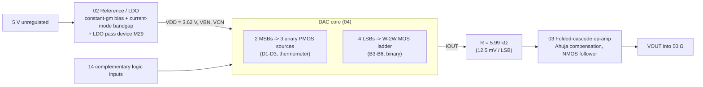
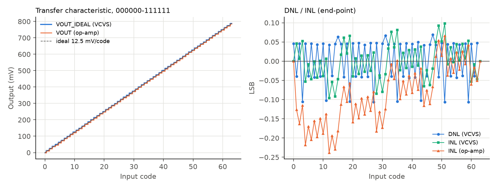
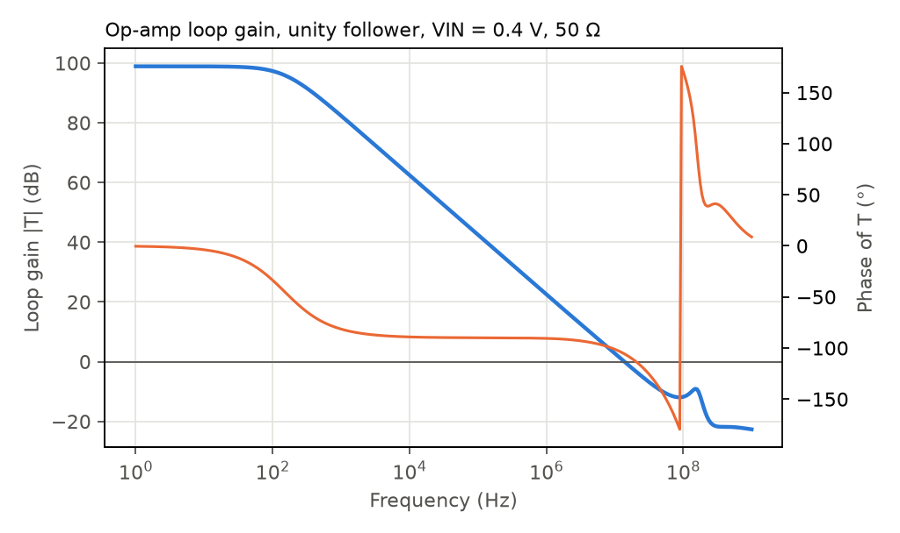
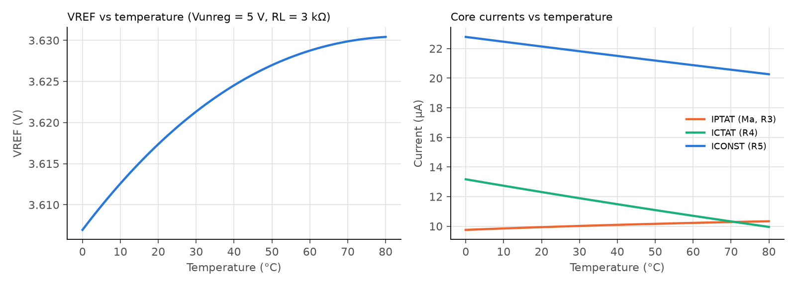

# 6-bit Segmented Current-Steering DAC in LTspice

A complete 6-bit digital-to-analog converter designed at transistor level and characterised in LTspice:
- an on-chip voltage reference / LDO regulator;
- a segmented current-steering core (unary MSBs and a MOS W-2W ladder for the LSBs);
- a ground-compatible folded-cascode output buffer.

Every schematic is generated by Python and checked against an intended netlist.

*Coursework project for EE4323 (analog IC design).*

## Problem
Design a 6-bit DAC with a 12.5 mV LSB, about 0–0.79 V full scale, that drives a 50 Ω load from a single 5 V
unregulated supply, using the course's CMOS and NPN device models. It must stay accurate over 0–80 °C and supply
variation, and it is characterised for linearity, speed, power and start-up.

## Architecture

| Schematic | Block |
|---|---|
| `01_Characterisation.asc` | NMOS / PMOS / NPN characterisation (I-V, body effect, temperature) used for sizing |
| `02_VREF_Regulator.asc` | Buffered current-mode voltage reference and LDO (the internal 3.62 V supply) |
| `03_Folded_Cascode_OpAmp.asc` | Ground-compatible folded-cascode op-amp with Ahuja compensation and a source-follower output |
| `04_Complete_6Bit_DAC.asc` | Full system: regulator + DAC core + op-amp, 50 Ω load, an ideal VCVS reference buffer for comparison, 14 logic sources |

## Results (LTspice, typical models, 27 °C unless stated)
Source: `Simulation_Results/*/summary.json`. The static numbers are re-derived from the committed CSVs by the tests.

**Complete DAC (50 Ω load)**

| Metric | Value |
|---|---|
| LSB / full scale | 12.47 mV / 785.7 mV (code 63) |
| DNL | −0.127 … +0.071 LSB |
| INL (end-point) | −0.239 … +0.062 LSB (best-fit \|INL\| ≤ 0.181 LSB) |
| Offset / gain error | ≈ 0 LSB / −0.141 LSB |
| Monotonic | yes (also at 1 MS/s) |
| Update rate | accurate to 0.005 LSB at 1 MS/s; errors reach 0.86 LSB at 2 MS/s |
| Output temperature coefficient, 0–80 °C | 21 ppm/°C (code 63), 37 ppm/°C (code 31) |
| Supply power at code 63 into 50 Ω | 88.8 mW total (regulator 28.7 mW, op-amp 2.6 mW, DAC core 0.68 mW) |
| Minimum unregulated supply (VOUT within ½ LSB) | 3.63 V (3.64 V without load) |

**Reference / LDO**: VREF = 3.620 V and settles to 1 mV in about 21 µs from power-up (0–80 °C, 4.5–5 V). The
temperature coefficient is 81 ppm/°C. Line regulation is 46 mV/V (4.5–5 V); load regulation is 16.3 mV for 0–50 mA.
Loop phase margins are 91° and 93°.

**Op-amp**: DC gain 84–101 dB, unity-gain frequency 8.4–16.8 MHz and phase margin 71–80° across the output range and
load. The input offset is −2.2 mV. It tracks 0–2 V within 2.2 mV without load, into 50 Ω, and when sinking 50 mA.

| Static transfer | Op-amp loop gain | Reference over temperature |
|---|---|---|
|  |  |  |

## Design method
- Each block has a Python "intended netlist" (`*_design.py`) and a schematic generator (`*_asc.py`).
- `asccheck.py` compares the netlist LTspice produces from the drawn schematic with the intended one. This catches
  wiring mistakes that a visual check would miss.
- `*_run.py` scripts netlist each schematic with LTspice, simulate it and write CSVs plus `summary.json`.
  `make_figures.py` plots only from those saved CSVs.
- `char_extract.py` extracts device parameters from the characterisation runs, and `sizing.py` uses them to size
  the devices (`Simulation_Results/device_sizing_table.csv`).

## Project structure
```
├── 01…04_*.asc, *.asy                 the four schematics and their custom symbols
├── Supporting_Documents/scripts/      generators, intended netlists, LTspice runners, checks, figures
├── Simulation_Results/<block>/        summary.json, figures and CSVs (< 2 MB each) per block
├── docs/history/                      design notes of the superseded 10 Nov iteration (numbers differ from the final design)
└── tests/                             checks that need neither LTspice nor the course models
```

## Reproducing
**Without LTspice** (checks the committed results and the generators):
```bash
python3.14 -m venv .venv && source .venv/bin/activate
pip install -r requirements-dev.txt
pytest          # 11 tests: all four schematics regenerate byte-identically; INL/DNL and TC in summary.json follow from the CSVs
```
**Full simulation** needs:
- LTspice (macOS build under Wine; set `LTSPICE_WINE` if it is not at the default path);
- the course model files `EE4323_cmos.mos` and `EE4323_bjt.lib` placed in the repository root. They are course
  material and are **not** distributed here;
- an LTspice `.raw` reader (the `ltspice-mcp` package; path via `LTSPICE_MCP_SRC`).

Then run, from the scripts folder: `python char_run.py`, `python reg02_run.py`, `python opamp03_run.py`,
`python sys04_run.py`, `python make_figures.py`. The large waveform CSVs (over 2 MB) are not committed; the run
scripts regenerate them.

## Limitations
- Simulation only, with typical course models: no process corners, Monte Carlo mismatch or layout parasitics.
- The reference's temperature coefficient (81 ppm/°C) is high for a bandgap. The output TC stays at 21–37 ppm/°C
  partly because the DAC current and the output resistor scale together.
- The op-amp's NMOS output follower draws most of the supply power at full-scale output into 50 Ω.
- The 10 Nov iteration in `docs/history/` reported a 7.3 ppm/°C reference. That design was replaced, and its numbers
  do not describe this one.

## Future work
Corner and Monte Carlo analysis of the W-2W ladder matching, a curvature-corrected reference, and a layout-aware
estimate of the switch parasitics that limit the update rate above 1 MS/s.

## References
1. Razavi, B. *Design of Analog CMOS Integrated Circuits*, 2nd ed. McGraw-Hill, 2017.
2. Johns, D., Martin, K. *Analog Integrated Circuit Design*. Wiley, 1997 (current-steering DACs, folded-cascode amplifiers).
3. Ahuja, B. K. (1983). An improved frequency compensation technique for CMOS operational amplifiers. *IEEE JSSC* 18(6).
4. EE4323 course handouts (design specification, device models): not redistributed.

The custom symbols (`*.asy`) are needed to open the schematics. The device models they refer to are course material
and are not included.
